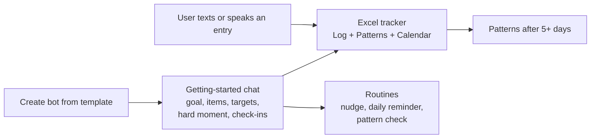
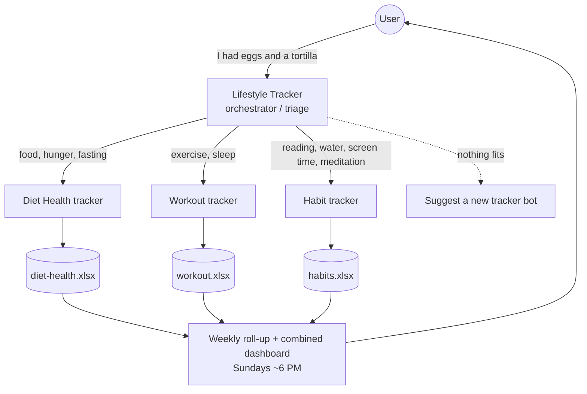
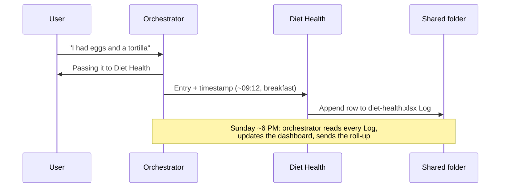
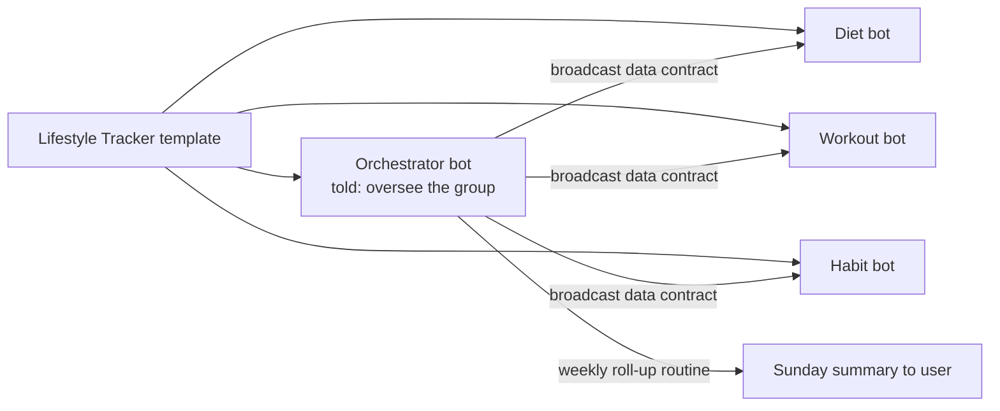

## Don't Track Everything in One Bot

I already knew this from running a multi-agent org: one mega-agent that tries to do everything gets mediocre at all of it. The same thing is true for lifestyle tracking.

Meals, workouts, sleep, and everyday habits don't belong in a single overloaded conversation. Each area has its own language, its own hard moments, and its own idea of what a useful nudge looks like. So I didn't build one tracker. I built a small system: one reusable template, one specialist bot per life area, and one orchestrator I actually talk to.

The template I started from is public: [Lifestyle Tracker by Eriberto](https://x.ai/bot/vfRCxatSj3q6uZu6sfEcK).

<a class="bot-card" href="https://x.ai/bot/vfRCxatSj3q6uZu6sfEcK" target="_blank" rel="noopener">

Lifestyle Tracker by Eriberto
A friendly, shame-free coach that logs anything you want to measure about your lifestyle, like meals, sleep, workouts, mood, or habits, in a spreadsheet, nudges you at your tough moments, and points out patterns once there's enough data.
Try the bot on x.ai

</a>

This isn't a medical tool, and it isn't trying to be precise. Everything is a rough estimate. Patterns only show up after at least five days of logs, so nobody draws conclusions from a noisy couple of entries.

## The Building Block: the Lifestyle Tracker Template

Every bot in this setup starts from the same Grok Bot template: a friendly, shame-free coach that logs whatever you want to measure — meals, sleep, workouts, mood, habits — in a spreadsheet, nudges you at your tough moments, and points out patterns once there's enough data.

On first run, the template walks through a short getting-started conversation, one question at a time:

1. **Name and goal** — lose weight, sleep better, read more consistently, whatever the area actually is.
2. **What to track, and how** — time, amount, a 1–10 rating, yes/no, or a freeform note.
3. **Targets** — dinner by 6 PM, three workouts a week, twenty minutes of reading a day, and so on.
4. **The hard moment** — when you're most likely to slip.
5. **Check-ins** — a nudge before that hard moment, a daily log reminder, and a pattern check.

Then it builds an Excel workbook with a Log tab, plus Patterns and Calendar tabs, and it creates the scheduled routines. After a tough moment, it sends one encouraging follow-up about 25 minutes later. That's the whole unit. I just ran it more than once.

## One Template, Three Specialists, One Orchestrator

I made one bot per life area, then added a fourth copy as the orchestrator:

* **Diet Health tracker** — meals (S/M/L size), hunger spikes (1–10), and fasts (hours).
* **Workout tracker** — workouts (minutes by type), sleep (hours), and sleep quality (1–10).
* **Habit tracker** (`Habit | Lifestyle Tracker`) — generic daily habits, logged as counts, minutes, or yes/no: reading, water glasses, screen time, meditation, and the like. An optional 1–10 urge rating can sit alongside an entry when that's useful.
* **Lifestyle Tracker**, the orchestrator — triage, a shared data contract, a combined dashboard, cross-tracker patterns, and a weekly roll-up.

I don't message the specialists day to day. I tell the orchestrator what happened — "I had eggs and a tortilla" or "I read for 20 minutes" — and it routes the entry. If nothing fits, it suggests spinning up a new tracker from the same template.

## The Glue: a Shared Six-Column Log

The agents share one computer, so they don't need a central database. They coordinate through a shared folder — in this setup, `/home/box/lifestyle-trackers/`. Each tracker owns exactly one workbook there. The first sheet is always called **Log**, and it always has the same six columns:

| Date | Time | Item | Value | Unit | Notes |
| -- | -- | -- | -- | -- | -- |
| 2026-01-05 | 08:30 | meal | M | size | oatmeal + coffee |
| 2026-01-05 | 07:00 | sleep | 7.5 | hr | bed 23:30, up 07:00 |
| 2026-01-05 | 17:30 | workout | 45 | min | easy run |
| 2026-01-05 | 21:00 | reading | 20 | min | after dinner |

Those rows are generic examples, not real log entries. A meditation session might be a yes/no. Water might be a glass count. An optional urge rating, when you use one, can live in Notes as a 1–10.

Trackers can add their own tabs — Patterns, Calendar, Workouts, whatever the specialist needs — but Log is the source of truth. A README in the folder documents the contract. That consistency is what lets the orchestrator read all three files and compare them, for example habits kept on workout days, or hunger spikes after a fast.

## How the Agents Talk

The bots message each other directly, asynchronously. An entry being routed looks like this:

Onboarding the specialists took one broadcast from the orchestrator: here's the shared format, and here's your file path. Each bot replied with its own conventions. Workout puts bedtime and wake time in Notes. Diet Health keeps its original workbook as the primary file and mirrors into the shared folder. The Habit tracker keeps units flexible — minutes, counts, or yes/no — so different daily habits can share one Log.

I didn't have to redesign anyone's tracker. I just made the Log sheet line up.

## How to Recreate It

If you want the same shape, you can build it from the Lifestyle Tracker template:

1. Create one bot per life area, named `<Area> | Lifestyle Tracker` — for example, `Sleep | Lifestyle Tracker` or `Habit | Lifestyle Tracker`. Answer that bot's getting-started questions for that area only.
2. Create one more copy from the same template as the orchestrator. On its first run, instead of picking a personal goal, tell it: "You oversee all agents in the lifestyle trackers group."
3. Tell it what overseeing means. I asked for four things: a combined dashboard, cross-tracker patterns, a weekly roll-up, and keeping everyone logging the same way.
4. Let the orchestrator set up the shared folder and the six-column Log contract, then have it message each tracker to adopt it.
5. Tell it: "You're my triage point. I'll tell you anything that might be logged, and you route it or tell me to create a new agent."
6. From then on, log everything through the orchestrator. When something doesn't fit, it suggests a new tracker. Spin one up from the template, and it joins the contract.

## Why This Shape Works

A few design choices are doing most of the work:

* **Specialists stay focused.** Each one keeps its own coaching voice, hard-moment nudges, and routines for a single area.
* **I only need one entry point.** I don't have to remember which bot owns what.
* **Coordination is a file contract plus messages.** There's no central database to maintain.
* **The tone stays shame-free and non-medical.** Patterns wait until there are at least five logged days, so the system doesn't overfit noise.
* **It extends easily.** A new life area is one more template bot and one more workbook in the folder. The Habit tracker is the simplest example of that: one more specialist, same contract, and readers can see how a new area plugs in.

That's the whole trick: reuse the same getting-started template, keep each specialist narrow, and put a thin orchestrator in front so the data can still be compared.

## Try it yourself

You can start from the same template and spin up your own specialists, plus an orchestrator in front of them.

<a class="bot-card" href="https://x.ai/bot/vfRCxatSj3q6uZu6sfEcK" target="_blank" rel="noopener">

Lifestyle Tracker by Eriberto
A friendly, shame-free coach that logs anything you want to measure about your lifestyle, like meals, sleep, workouts, mood, or habits, in a spreadsheet, nudges you at your tough moments, and points out patterns once there's enough data.
Try the bot on x.ai

</a>

1. Open [Lifestyle Tracker by Eriberto](https://x.ai/bot/vfRCxatSj3q6uZu6sfEcK) and start a bot from the template.
2. Create one bot per thing you track. I use one for diet, one for workouts, and a habit tracker for reading, water, screen time, and meditation.
3. Add an orchestrator from the same template. I tell it to route each entry to the right specialist and write the weekly roll-up.
4. From then on I log through the orchestrator. When something doesn't fit, I start another specialist from the template.

---

*This is part of the **Agentic Engineering** series — documenting the real operational lessons of running AI agents as teammates, not just tools.*
