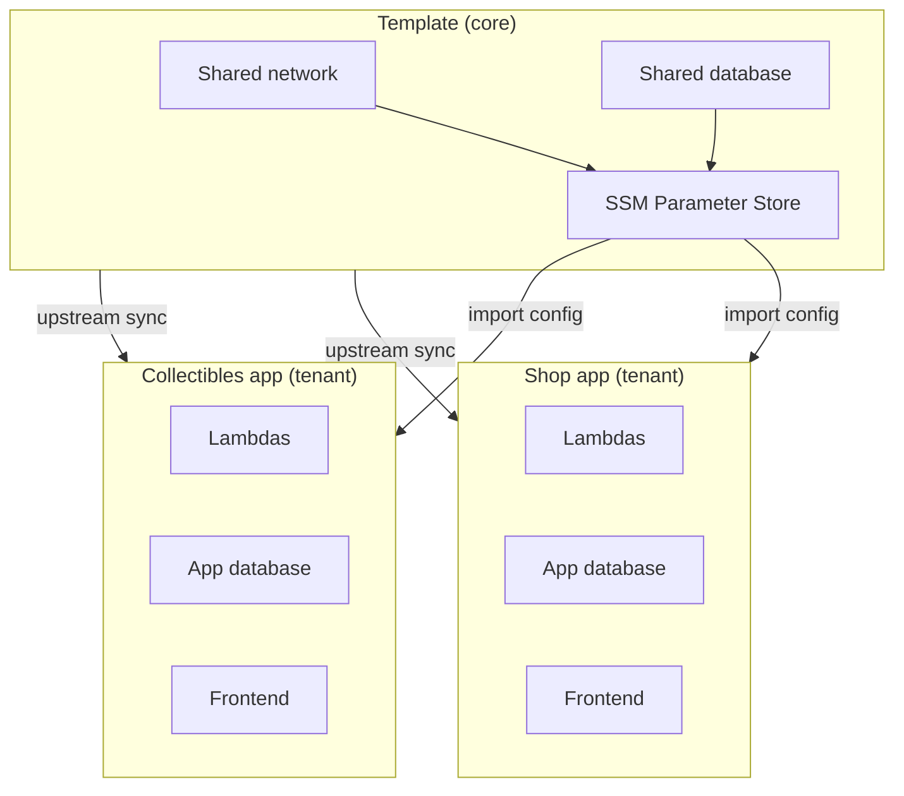
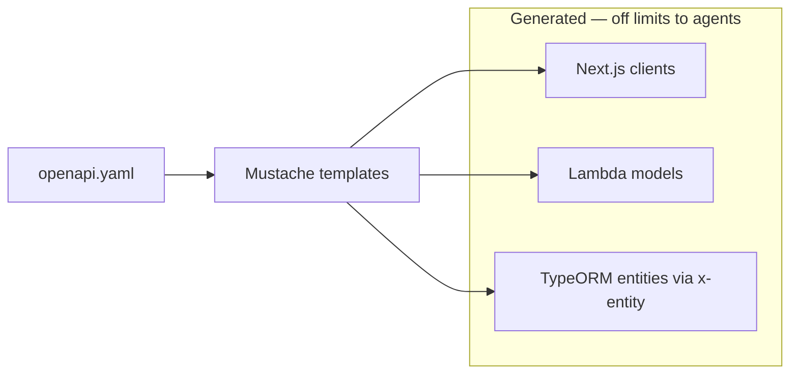
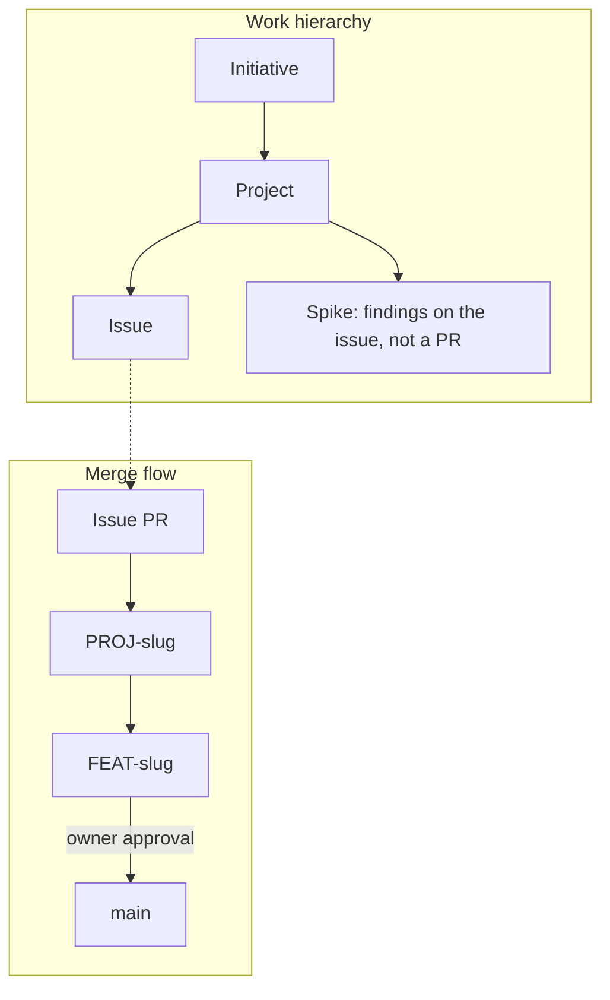
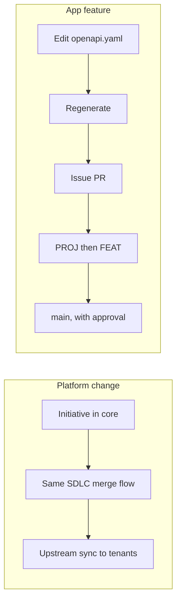

A core/tenant platform, an OpenAPI contract, and a Linear SDLC, designed to work in tandem so coding agents work the same way on every app.

I kept starting side projects the same way: a new repo, a new pile of AWS plumbing, and a new set of habits for whatever coding agent I was using that week. The first feature was never the hard part. The hard part was standing up a network, a database, auth, and a frontend pipeline, then watching an agent invent a slightly different way of working because this repo didn't have the same rules as the last one. A starter repo alone doesn't fix that, and a process doc alone doesn't either. What I needed was three things that reinforce each other: a core/tenant topology, a codegen contract, and an SDLC hierarchy with a clear merge flow.

## The core/tenant topology

The template is a serverless full-stack monorepo: a Next.js static site, API Gateway and Lambda, and infrastructure in AWS CDK. Locally, Docker brings up Postgres, LocalStack, and a Swagger UI so the same stack can run on a laptop.

A single project-config file names the app and sets a deployment mode that cascades through the stacks:

- **Core** is the platform origin. It creates the shared network and shared database, then publishes that configuration to SSM Parameter Store.
- **Tenant** is how real apps run. They import the shared resources from SSM and add only what is theirs: their Lambdas, their own database on the shared server, their frontend. In my case, that's a shop app and a collectibles app.
- **Standalone** is the escape hatch: a fully self-contained deploy, including into an existing network.

Forking is a config change, not a rewrite: name, slug, tenant mode, and a few GitHub environment variables. An init script updates the config, compose file, OpenAPI title, package names, and theme. A scaffold skill creates the repo and points `upstream` at the template; a sync skill pulls later changes while preserving tenant identity.

The topology decides where work lives. A platform change belongs in core, then flows to tenants through an upstream sync instead of being rebuilt in each app. An app feature belongs in the tenant: it uses the shared network and database, and adds only what that app needs.

## The codegen contract

The center of each repo is the OpenAPI spec. I define the API once in `openapi.yaml`, and Mustache templates generate the TypeScript clients, the Lambda-facing models, and — when a schema is marked with `x-entity` — the TypeORM entities. Change the spec, regenerate, and both sides stay in sync.

This is what makes work issue-sized. An agent does not invent one shape in the frontend and a different one in the backend. It edits the spec, regenerates, and implements against generated types. Generated files are off limits. The ticket can be "add this resource to the contract and wire the behavior," which maps cleanly onto a single issue. Per-layer Cursor rules and a top-level `CLAUDE.md` encode that agreement, and a knowledge file updated by CI keeps it from going stale. A Cloud Agent environment in the repo means a cloud agent doesn't spend half a session rediscovering how to boot the project.

## The SDLC hierarchy and merge flow

Plans, specs, and working agreements live in Linear, not the repo — I even moved planning docs out of the template for that reason. A small set of SDLC documents, titled so an agent can search for "SDLC" and find them, covers how work is organized and how it merges.

Work sits in three levels. An **initiative** is a long-running outcome with a one-sentence "done looks like." A **project** is a shippable chunk of that initiative, with a spec for the goal, scope, branch, open questions, decisions, and milestones. An **issue** is small and outcome-based. A **spike** is research, not delivery: a timebox and a written answer on the Linear issue or project spec, not a pull request.

Each level has a branch. The initiative gets one long-lived `FEAT-` branch off `main`. Projects branch off that as `PROJ-`. Issues branch off their project, usually with Linear's default name so the pull request links back to the ticket. Merges flow issue to project to feature branch to `main`. Nothing merges to `main` without my approval. User testing happens on the feature branch's preview environment.

Before creating a branch, opening a pull request, or launching a cloud agent, the rule is to search Linear for those SDLC docs and read the one that matches the task. UI pull requests need before and after screenshots at 390px and 1440px, plus a short recording if anything is interactive. Reviewers don't treat a UI change as ready without that. The process is the same in every app, including ones that didn't come from the template.

## How they work in tandem

The interesting part is not any one of these pieces. It's how they correct each other's failure modes.

Take an app feature — a new workflow in the shop app. It starts as a project under an initiative. Open questions become spikes, written back on the issue. Implementation stays issue-sized because the contract is the unit of change: edit `openapi.yaml`, regenerate, implement. Each issue pull request targets the project's `PROJ-` branch, which merges into the initiative's `FEAT-` branch for user testing, then to `main` with my approval. The tenant topology keeps the feature in the shop app. It uses the shared core and adds only what the shop needs.

A platform change is the same process, pointed at a different place: an initiative in core, then the same merge flow, then an upstream sync. Tenants keep their names, themes, and tenant mode, and pick up the change without each becoming its own platform.

Without the contract, issue-sized tickets sprawl across handwritten types on both sides of the API. Without the topology, every platform fix gets reimplemented, or a tenant quietly starts owning shared infrastructure. Without the SDLC, agents still improvise: a pull request for a spike, no visual proof, a merge straight to `main`. Together, an agent can find the SDLC docs, know whether the work is a core change or a tenant feature, and know that the spec is the one place to change the shape of the API.

## What I'd do differently

Squash-merging template updates into a tenant was a mistake. The code looked current, but git still treated the template commits as missing. I had to come back and merge with a real merge commit so template `main` became an ancestor again. If you keep a template and forks, don't squash the syncs.

And I should be honest about the process. The Linear SDLC docs are recent. Most of the git history is pull requests straight into `main`, and the formal `FEAT-` and `PROJ-` names barely appear in the branches. The shop app did use the idea before the names existed: a long-lived project branch, with issue pull requests targeting it, then one merge back to `main`. This is the process I want going forward, layered on a platform that was already in place. It is not something the template has been enforcing all along.

## Takeaways

- Treat topology, contract, and process as one system. Each is weaker without the other two.
- Put shared network and database in core, publish them through SSM, and keep app features in tenants. Flow platform changes through upstream sync, not copy-paste.
- Put the API in one OpenAPI spec and generate the rest. Agents edit the spec, not generated files.
- Keep the SDLC in Linear. Spikes write findings; issue pull requests merge into `PROJ-`, then `FEAT-`, then `main` only with your approval.
- Don't squash template syncs. Preserve git ancestry, and protect tenant identity in every merge.
- UI work needs visual proof at mobile and desktop widths. If it isn't on the pull request, it isn't ready.

If I start a new app tomorrow, I don't rebuild the plumbing, and I don't invent a new way of working. I scaffold a tenant, point it at the shared core, and follow the same SDLC an agent can already find.
