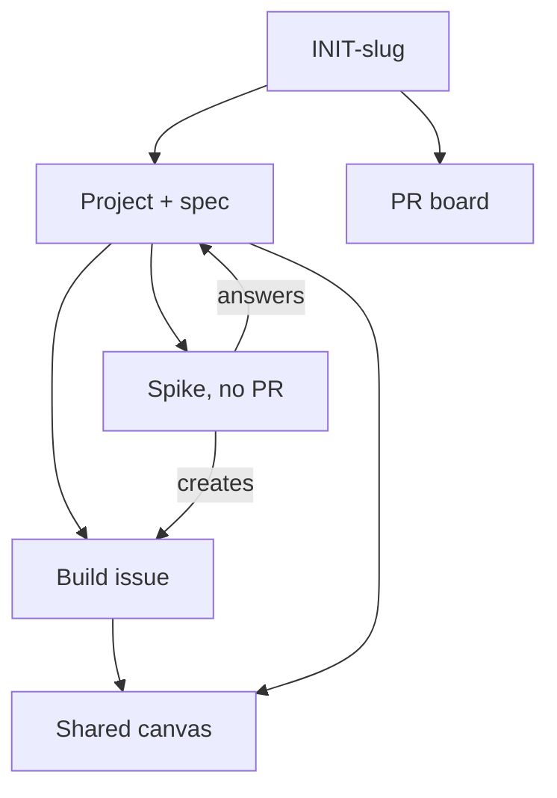
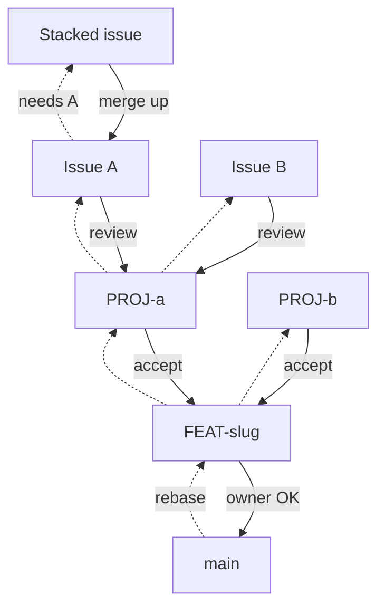

## Why I needed a process agents can follow

I already knew AI agents could write code. The harder problem was which branch they cut, what "done" means, and who is allowed to touch `main`.

Without an explicit SDLC, each agent invents a slightly different workflow. One opens a PR to `main`. Another buries a plan in a file the next agent never reads.

So I wrote the process down in Linear — not in the repo — and made every agent read it first. I used it this week to close a design-alignment initiative on AskEV and merge it to `main` only after I signed off.

## Try it yourself

Click the card, start the bot, and paste this prompt. The five starter docs are in [the starter kit](#starter-kit) at the end of this post.

<a class="bot-card" href="https://x.ai/bot/ri2a49hVgpoWFsm53uhSK" target="_blank" rel="noopener">

Linear SDLC by Eriberto
Drives engineering initiatives end to end from your Linear SDLC process docs: creates initiatives, projects, specs, spikes and issues, launches Cursor Projects and cloud agents on the right branches, tracks PRs, and never merges to main without your approval.
Try the bot on x.ai

</a>

<button type="button" class="prompt-copy" onclick="(function(b){var t=b.parentNode.querySelector('code').innerText;navigator.clipboard.writeText(t).then(function(){b.textContent='Copied';setTimeout(function(){b.textContent='Copy'},1600)}).catch(function(){b.textContent='Select to copy'})})(this)">Copy</button>
<pre><code>Read the starter kit at https://eribertolopez.com/latest/sdlc-grok-cursor-linear#starter-kit&#10;&#10;Use the five SDLC docs in that section. Create them in my Linear workspace, connect Linear and GitHub, and drive my first initiative from those docs. Do not merge to main without my approval.</code></pre>

## The three pieces

**Linear** is the source of truth. Initiatives, projects, issues, spikes, and specs live there. Status updates go on the initiative or project. Measurements and visual results go on a shared Cursor canvas, linked from Linear.

**The Grok bot** is the initiative driver. Mine is published as Linear SDLC. It drives engineering initiatives end to end from the Linear SDLC process docs: it creates initiatives, projects, specs, spikes, and issues; launches Cursor Projects and cloud agents on the right branches; tracks PRs; and never merges to `main` without my approval.

**Cursor cloud agents** do the building. Independent issues can run in parallel. When a project can be parallelized, a Cursor Project — a coordinator agent — spawns those sessions. Spike agents do not open PRs; they write findings and follow-up tickets in Linear, then stop.

I stay in the loop for taste and for the last merge. Nothing lands on `main` without my explicit approval.

## How tickets are organized

Work has three levels:

- **Initiative** — a long-running outcome with a one-sentence "done looks like," named `INIT-<short-slug>: <plain title>`. Examples: `INIT-shop-app`, `INIT-daily-ev`, `INIT-askev-ui`, and `INIT-askev-align`.
- **Project** — a shippable chunk with milestones and a Linear spec. If new work does not fit, we propose a new project rather than leaving issues loose.
- **Issue** — the unit of work, owned by a team (ROB for pokeTrader, COAST for the shop app). UI issues list visual proof: before and after screenshots at 390px and 1440px, plus a recording for anything interactive.
- **Spike** — research, not delivery. It is done when the question is answered in writing and follow-up issues exist, not when code ships.

Teams own issues. Projects and initiatives group them.

## Branching, PRs, and merges

Each initiative gets one long-lived feature branch, `FEAT-<same-slug>`, cut from `main` and rebased regularly. It gets its own preview environment; real user testing happens there, not on `main`.

Projects branch off it as `PROJ-<slug>`, never off `main`. Issues branch off their project, using Linear's generated name so the PR links to the ticket. Independent issues run in parallel; dependent ones stack about three deep and merge from the bottom up.

Dashed arrows are branching and rebasing. Solid arrows are PRs and merges. Issue PRs get tests, review, and visual proof for UI. A project branch gets an acceptance check. The feature branch merges to `main` only once "done looks like" is met and I approve.

## How the pieces align

If you know the ticket, you should be able to name the branch and the PR target.

- **Initiative** `INIT-<slug>` — branch `FEAT-<slug>` off `main`. The PR is the feature branch into `main`. I approve that merge; the driver bot can prepare it.
- **Project** — branch `PROJ-<slug>` off the feature branch. The PR goes into `FEAT-<slug>` after an acceptance check.
- **Build issue** — Linear's issue branch off the project. The PR goes into `PROJ-<slug>`, or onto a stacked issue branch. A Cursor cloud agent, or a Cursor Project session, does the work.
- **Spike issue** — no delivery branch and no PR. Findings and follow-up tickets are written in Linear.

The names are mechanical. `INIT-askev-align` always means `FEAT-askev-align`. ROB-113 always carries a branch with `rob-113` in the name.

## A real walkthrough: INIT-askev-align

On November 19, 2026, at 10:17 PM Pacific, the AskEV UI refresh (`INIT-askev-ui`) landed on `main`. A mock review with 390px and 1440px screenshots scored it at 73% — 31 of 45 items aligned, 4 partly. The biggest gap was the desktop card panel.

That evening I opened `INIT-askev-align`. "Done looks like": every review item is aligned on `main`, or I logged a decision that overrides the mock. Four projects, each with a spec and a `PROJ-` branch off `FEAT-askev-align`:

- Desktop card panel — ROB-113, ROB-114, pokeTrader#98
- Mobile card views — ROB-118, ROB-119, pokeTrader#96
- Trade mode Next card and step size — ROB-115, ROB-116, ROB-117, pokeTrader#97
- Shell, states and copy — ROB-120, ROB-121, pokeTrader#99

Issue PRs targeted those project branches, not `main`. ROB-113 landed on `PROJ-askev-align-desktop-card` after a rebase once ROB-114 was in. ROB-116 included before/after shots at both widths, a recording, and a test that failed if the step reset.

Not everything was a PR. ROB-122 was a spike ("No PR") on loading, empty, error, and "not scored" states. Findings went into the spec and a canvas. ROB-124 was moved out of scope; ROB-123 was closed without code.

The four project PRs merged into `FEAT-askev-align`. I signed off, and pokeTrader#100 — `FEAT-askev-align` → `main` — merged on November 20, 2026, at 9:19 AM Pacific.

## What this gets me, and what still needs work

The obvious benefit is parallelism without chaos: four project branches can move at once, with one named integration point. Spikes stay research. UI PRs without 390px and 1440px before/after — and a recording for interactive changes — are not ready. I still own the merge to `main`.

The first real use also showed the seams. Linear lagged GitHub: after the merge to `main`, the initiative was still Planned, and a few older tickets were still open. Rebasing a moving `PROJ-` branch was already real work — ROB-113 had to be rebased after ROB-114 landed. I am the approval bottleneck on purpose, which is also the slowest step. Visual proof is expensive, and I am keeping it. And if a Linear spec is stale, the next agent will follow it with great confidence.

The promise is not that I type less. It is that several streams of work can still reassemble into something I am willing to put on `main`. Linear holds the intent. Cursor agents hold the implementation. The Grok bot holds the thread.

<h2 id="starter-kit">Try it yourself: the starter kit</h2>

Start with the Linear SDLC bot, then paste the prompt so it can copy the starter docs from this page.

<a class="bot-card" href="https://x.ai/bot/ri2a49hVgpoWFsm53uhSK" target="_blank" rel="noopener">

Linear SDLC by Eriberto
Drives engineering initiatives end to end from your Linear SDLC process docs: creates initiatives, projects, specs, spikes and issues, launches Cursor Projects and cloud agents on the right branches, tracks PRs, and never merges to main without your approval.
Try the bot on x.ai

</a>

Click the card, start the bot, and paste this prompt.

<button type="button" class="prompt-copy" onclick="(function(b){var t=b.parentNode.querySelector('code').innerText;navigator.clipboard.writeText(t).then(function(){b.textContent='Copied';setTimeout(function(){b.textContent='Copy'},1600)}).catch(function(){b.textContent='Select to copy'})})(this)">Copy</button>
<pre><code>Read the starter kit at https://eribertolopez.com/latest/sdlc-grok-cursor-linear#starter-kit&#10;&#10;Use the five SDLC docs in that section. Create them in my Linear workspace, connect Linear and GitHub, and drive my first initiative from those docs. Do not merge to main without my approval.</code></pre>

**How to bootstrap**

1. Click the card and start the Linear SDLC bot.
2. Paste the prompt so the bot reads this starter kit and creates the five SDLC docs in your Linear workspace.
3. Connect Linear and GitHub, then let it drive your first initiative. Nothing merges to `main` without your approval.

Process docs are titled `SDLC`, then a space and a plain name. Agents search Linear for `SDLC` and read the doc that matches the task. Expand any doc below for a short intro, then a copy of the current Linear doc, with private links and app names taken out.

<strong>SDLC How we work</strong> — how initiatives, projects, and issues are organized

Initiatives, projects, and issues; status updates on the initiative or project; plans in Linear. It includes the project lifecycle, a **spike template**, and the bar for a good issue.

This is how we run software side projects. Keep work small, keep Linear documents as the source of truth, and let issues stay short and outcome-based.

## Initiatives, projects and issues

Work is organized in three levels. Teams own issues; projects and initiatives group them.

* **Initiative**: a long-running outcome that lasts months. Each one has a one-sentence "done looks like" and a target quarter. Status updates are posted on the initiative.
* **Project**: a shippable chunk of an initiative, with start and end dates and milestones. Every project belongs to an initiative. Its spec and design and decision docs live as Linear docs on the project, never in the repo.
* **Issue**: the actual work. Every issue is owned by a team (COAST for the shop app, ROB for [private app]), and a project can pull issues from several teams.

### Rules

* New work goes into the right project under an initiative. If no project fits, propose a new project instead of leaving issues loose.
* Post status updates on initiatives and projects, not in issue comments.
* Measurements and visual results go on a shared Cursor canvas, linked from the issue or project. Tracking stays in Linear.

### Current initiatives

* **INIT-shop-app: Shop app launch**: Shop reshape: customers, bookings, job statuses, events; Agent check-in and service tokens; Shop backlog gaps.
* **INIT-daily-ev: Automate daily EV history and card data updates**: [private app]: daily run observability; [private app]: serve fresh processed data; [private app]: unattended daily scheduler; [private app]: server-side [data source] access.
* **INIT-askev-ui: AskEV UI Design Refresh**: AskEV UI: Foundation and app shell; AskEV UI: Landing page and sign-in; AskEV UI: Card list and card views; AskEV UI: Sets browser; AskEV UI: Trade mode; AskEV: raw price range data source.
* **INIT-mechanic-shop-ui: Mechanic shop UI design refresh**

## Branches and PRs

Each initiative has one long-lived `FEAT-<slug>` branch off `main`, rebased onto main regularly. Projects branch off it as `PROJ-<slug>`. Issues branch off their project using Linear's default branch name, in parallel worktrees or stacked. Merges flow issue → project → feature branch → `main`. Nothing merges to `main` without Eri's approval. User testing happens on the feature branch's preview/dev environment.

The full rules are in **SDLC Branching Model**. Coding agents should also follow **SDLC Agent rules**.

## Project lifecycle

1. Create the project and a project spec from the **SDLC Project spec template**. That spec is the primary reference for the project.
2. Start with timeboxed spikes for the open questions in the spec.
3. When a spike finishes, write the findings into the project spec (or a linked project doc) and create the follow-up issues.
4. Group issues by project milestone — one milestone per feature or feature set.
5. Build the issues in cycles. Keep each issue small enough to finish in a few days.
6. At the end of each milestone, review and update the project spec so it stays current.

## Spikes

A spike is research, not delivery. Give it the **Spike** label and a short timebox (usually a day or two). It is done when the question is answered in writing, not when code ships.

### What makes a good spike

* One clear question
* A timebox you will actually stop at
* A written answer in the project doc
* Follow-up issues created from what you learned

### Spike template

Copy this into the issue description:

**Question:** What do we need to learn?

**Timebox:** 1–2 days

**Done when:** The answer is written in the project doc and follow-up issues exist.

**Findings link:** \[link to the project spec or section\]

**Issues created:** \[list or link the issues\]

## Issues

Issues are the pieces of work needed to build a feature or feature set.

### What makes a good issue

* Outcome-based: "User can reset password," not "Work on auth"
* Small enough for one person to finish in a few days; split it if it is larger
* Links to the project spec or relevant doc instead of copying the plan into the description
* Belongs to a project milestone when it is part of a feature set

### UI visual proof

Every PR that changes UI must include before and after screenshots at 390px (mobile) and 1440px (desktop), plus a short screen recording for anything interactive (flows, animations, state changes). List this in the issue's acceptance criteria and in every coding agent brief. Reviewers do not treat a UI PR as ready without it. Larger visual results can go on a shared Cursor canvas linked from the issue.

## Milestones

Use project milestones to group issues for a feature or feature set. The milestone shows progress without creating a separate project per feature. When a milestone finishes, review the project spec: update decisions, close or add open questions, and keep scope accurate.

## Docs as the source of truth

Plans and documentation live in Linear documents, not in issue descriptions.

* Keep one main project spec (goal, scope, decisions, open questions, milestones)
* Add separate docs only for large topics such as architecture or an API design
* Link to docs from issues; do not copy the same text into every issue
* Update the spec at the end of every milestone so it does not go stale

<strong>SDLC Branching Model</strong> — FEAT, PROJ, and issue branches, and how they merge

The primary git reference. One `FEAT-<slug>` per initiative, `PROJ-<slug>` off that, issue branches off the project or stacked about three deep, merging bottom-up.

How work moves from issue to `main` in this workspace. It applies to every initiative, in both ROB and COAST.

## Diagram

Dashed arrows are branching and rebasing; solid arrows are merges and PRs. `main` is rebased into the initiative's feature branch, projects branch off the feature branch, and issues branch off their project. Merges flow back up: issue → project → initiative → `main`.

## Naming conventions

| Level | Name | Example |
| -- | -- | -- |
| Initiative | `INIT-<short-slug>: <plain title>` | `INIT-daily-ev: Automate daily EV history and card data updates` |
| Initiative feature branch | `FEAT-<same-slug>` | `FEAT-daily-ev` |
| Project branch | `PROJ-<slug>` | `PROJ-daily-scheduler`, `PROJ-run-observability` |
| Issue branch | Linear's default `<team>-<number>-<slug>` | `rob-120-add-cron-trigger` |

The feature branch uses the same slug as its initiative, so `INIT-daily-ev` always maps to `FEAT-daily-ev`. Issue branches keep Linear's generated name so PRs link to the issue automatically.

## Rules

1. **One initiative, one feature branch.** Each initiative has exactly one long-lived `FEAT-<slug>` branch, created from `main`.
2. **Rebase onto main regularly.** Rebase the feature branch onto `main` weekly, or whenever `main` moves, so it never drifts far.
3. **User testing happens on the feature branch.** The feature branch has its own preview or dev environment, and that is where real user testing happens.
4. **Merge to main when "done looks like" is met.** The feature branch merges to `main` only once the initiative's one-sentence "done looks like" is met and Eri approves.
5. **Projects branch off the initiative branch, not main.** `PROJ-<slug>` is created from `FEAT-<slug>` and merges back into it. A project branch gets an acceptance check against the project's goal before it merges.
6. **Issues branch off their project.** Independent issues run in parallel, each in its own worktree. An issue that needs another issue's code is stacked on it (its PR targets that issue's branch); keep stacks to about three deep and merge from the bottom up. Issue PRs get automated tests and code review.

## Where to test

| Level | Testing |
| -- | -- |
| Issue PR | Automated tests and code review. PRs that change UI also need visual proof: before and after screenshots at 390px (mobile) and 1440px (desktop), plus a short screen recording for anything interactive. |
| Project branch | Acceptance check against the project's goal |
| Initiative feature branch | Real user testing on its own preview or dev environment |

## Process doc naming

Every process doc title starts with `SDLC`, then a space and a plain descriptive title. There is no dash or category suffix.

Examples:

* SDLC Branching Model
* SDLC How we work
* SDLC Project spec template
* SDLC Agent rules

Agents search Linear documents for `SDLC` to find every process doc, then pick the one whose title matches the task at hand (for example, read SDLC Branching Model before creating a branch, and SDLC Agent rules before launching an agent).

Existing type prefixes such as `PRD:`, `Template:`, `Plan:` and `Brief:` can stay on the docs that already use them. New process docs follow the `SDLC` convention.

## Status reports

Each initiative's and project's status update links its PR approval board (see the PR approval board template doc).

<strong>SDLC Agent rules</strong> — what every agent must read before it starts

Before any branch, commit, PR, or agent launch, search Linear for `SDLC`, read the matching doc, and put the same instruction in every brief. Docs stay in Linear. Nothing merges to `main` without my approval.

Rule for every agent working in this workspace (Linear Bot, PRDesigner, Cursor Bot, and any Cursor cloud agent or Project they launch), in both ROB and COAST.

## Before you start

Before creating a branch, making a commit or opening a PR, or launching any work (a cloud agent, a Cursor Project, a new initiative or project):

1. Search Linear documents for `SDLC`.
2. Read the process doc whose title matches the task at hand (for example, SDLC Branching Model before creating or rebasing a branch, and this doc before launching an agent).
3. If no doc covers the task yet, follow the primary reference below.

## Primary reference

**SDLC Branching Model** is the primary reference. It covers the initiative feature branch, project and issue branches, naming, where user testing happens, and the **Process doc naming** section with the full `SDLC` convention.

## Still applies

* Never merge to `main` without Eri's explicit approval.
* Docs live in Linear, never in the repo.
* Each team's SDLC How we work doc still applies alongside these.
* Every PR that changes UI must include visual proof: before and after screenshots at 390px (mobile) and 1440px (desktop), plus a short screen recording for anything interactive (flows, animations, state changes). List this in the ticket's acceptance criteria and in every coding agent brief. Reviewers do not treat a UI PR as ready without it. Larger visual results can go on a shared Cursor canvas linked from the Linear issue.

<strong>SDLC Project spec template</strong> — the starter doc for every project

Copied into a new project document: Goal, Why, Scope, Branch, Open questions, a decisions log, Milestones, and Links.

Copy this into a new project document at the start of a project. Keep it current. Review it whenever a milestone finishes.

## Goal

What are we building, and what does "done" look like?

## Why

Why does this matter now? What problem does it solve?

## Scope

### In

* 

### Out

* 

## Branch

Project branch: `PROJ-<slug>`, created from the initiative's `FEAT-<slug>` branch and merged back into it after an acceptance check against the Goal. Issue PRs target this branch. See **SDLC Branching Model**.

Every issue that changes UI must list visual proof in its acceptance criteria: before and after screenshots at 390px (mobile) and 1440px (desktop) on the PR, plus a short screen recording for anything interactive (flows, animations, state changes). Reviewers do not treat a UI PR as ready without it. Larger visual results can go on a shared Cursor canvas linked from the Linear issue.

## Open questions

Spikes to run. Each question should become a timeboxed Spike issue. Link the issue and record the answer here when it is done.

| Question | Spike | Timebox | Status | Answer / link |
| -- | -- | -- | -- | -- |
|  |  |  |  |  |

## Decisions log

Record decisions as they are made so the reasoning is not lost.

| Date | Decision | Reason |
| -- | -- | -- |
|  |  |  |

## Milestones

One milestone per feature or feature set. Link the Linear milestone and list the outcomes it covers.

| Milestone | Outcomes | Target |
| -- | -- | -- |
|  |  |  |

## Links

* Project:
* Related docs:
* Repo:
* Other:

<strong>Template: PR approval board (status report)</strong> — a read-only merge-order Page

A recipe for a read-only Page of open PRs awaiting approval, the merge-order tree, and mismatches. Status updates should link one. Building it never merges or rebases.

Status: Active. This is the standard status-report template for every initiative and project in this team (added 2026-11-19 at Eri's request). A coding agent or bot asked for "PRs awaiting approval", "merge order", or a status breakdown at any level (initiative, project, or repo) builds this Page and links it from that initiative's or project's status update. The same recipe is saved as the shared Grok Bot skill "PR approval board".

# PR approval board (status report Page)

Builds one shareable Page (a canvas) for a single initiative, project, or repo. It shows every open pull request waiting on the owner's approval, the order they should merge in, the stacking tree, and anything that doesn't add up. This is a read-only snapshot. Never merge, approve, rebase, or comment while building it.

## When to use

* The owner asks "what PRs need my approval", "what's the merge order", or for a status breakdown of an initiative, project, or repo.
* At any level of the hierarchy. **Initiative**: every PR from all its projects, grouped by project. **Project**: only that project's PRs. **Repo**: every open PR, with PRs outside any initiative flagged as "outside".
* To refresh an existing board, edit that Page. Don't make a new one.

## Inputs to collect first

1. Scope: which initiative, project, or repo, and its Linear link.
2. Repo(s): owner/name.
3. Ticket prefix and Linear team (for example ROB-, COAST-).
4. Project names that the PR branches or tickets map to.
5. Any decisions log the board should check PRs against.

## Data gathering (live, this run)

For every open PR in scope, get:

* Number, title, URL, author or agent, created time (in the owner's time zone), and whether it's a draft.
* **Base branch** and head branch. The base is the real stacking parent. Trust it over any description or stack metadata.
* Mergeable state or conflicts against its base.
* Checks: list each check by name, conclusion, and *description*. Read the description, because "success" with "Canceled by Ignored Build Step" means nothing ran. Note when there are no test or lint checks, and say that test counts came from the PR body, not a live check.
* The linked ticket (from the title, branch, or body) and its project, status, and any blocking relations.
* Visual proof: whether the body has 390px and 1440px screenshots and recordings, is logic-only, or isn't UI.
* What the body says about dependencies ("merge after #N", "contains #N's commits", "soft dependency") and official GitHub stacks.
* Open questions or pending owner decisions tied to that PR (from the ticket or decisions log).

Then compute:

* **Ready**: `merge-now` (ready to merge into its own base branch, whether that base is `main`, a `FEAT-` branch, a `PROJ-` branch, or a stacked issue branch, and there are no conflicts), `wait-parent` (stacked on an open PR), or `anytime` (outside the stack).
* **Merge order**: a topological order over the base-branch tree, merging bottom-up: issue branches into `PROJ-<slug>`, `PROJ-<slug>` into `FEAT-<slug>`, `FEAT-<slug>` into `main`. Roots that unblock the most children go first. Independent PRs whose base is not an open PR come next. Soft dependencies break ties.
* **Mismatches**: base branch vs description vs official stack disagreements, PRs that carry another PR's commits, tickets that are cancelled or superseded but still have an open PR, and stale wording against the decisions log.

## Page template (sections, in this order)

 1. **Title**: "<Scope name> PRs awaiting your approval", with a snapshot line that has the exact time and time zone, plus "Nothing was merged or changed."
 2. **Callout (info), Suggested first merges**: the 1–3 PRs to merge first and why.
 3. **Metrics**: total open, merge now, waiting on a parent, outside scope, conflicts, drafts.
 4. **Callout (warning), What checks actually show**: the honest state of CI, especially when green checks don't run tests.
 5. **Merge-order tree**: a Diagram (mermaid-style graph) of the tree `main` <- `FEAT-<slug>` <- `PROJ-<slug>` <- issue branches (stacked issues under their parent issue), merging bottom-up. Label nodes "#N TICKET short title", and show soft dependencies as dashed edges.
 6. **PR table** (interactive): a search Input, a Project Select, Ready and Visual-proof Segmented filters, and sortable columns. The columns are step, PR link, ticket link, project, summary, depends on, checks, visual proof, notes, ready, created. Keep filter state with useCanvasState.
 7. **Independent PRs, no stacking**: a small table of PRs whose base is not an open PR (they may target `main`, a `FEAT-` branch, or a `PROJ-` branch).
 8. **Recommended merge order**: Steps, one per PR, with "after #N" and "then rebase/retarget children" notes.
 9. **Project breakdown** (initiative scope only): one Section per project with its goal, its PRs, and its open owner questions.
10. **Mismatches and surprises**: a bullet list.

Data lives in one typed `PRS` array at the top of the canvas source, so a refresh only edits the data. Link every PR to its full GitHub URL and every ticket to its Linear URL.

## Delivering

* Reply in one or two lines with the Page link, the count that can merge now, and the most important surprise (for example, checks that don't run tests).
* Don't paste the table into chat.
* Visual or audit results go on the Page. Lasting tracking and decisions go in Linear.

## Dispatch prompt (copy, fill the <> parts)

> Build a Page (canvas, via WriteCanvas; load the canvas skill first) titled "<Scope> PRs awaiting your approval" for <initiative/project/repo + Linear URL> in repo <owner/name>, ticket prefix <PREFIX>. Follow the PR approval board skill: for every open PR, pull the live base branch, mergeable state, every check with its description, the linked ticket and project, visual-proof status, and stated dependencies. Compute ready state, a topological merge order from base branches, and mismatches. Lay out the page in the skill's section order with an interactive filterable table and a merge-order diagram. Read only: never merge, approve, rebase, comment, or edit tickets. Report the Page link, the snapshot time with time zone, the merge order, the counts, and the mismatches.

## Reference build

The first board built with this layout is the visual reference. To start from working code, open it with ReadCanvas and copy it: [private canvas link] (a typed PRS array, MergeTree using Diagram, and PrTable with useCanvasState filters). Swap in the new data. Keep the structure.

There is no separate issue or initiative template; those patterns live in **SDLC How we work** and the branching model's naming rules. A new team needs these five documents, a GitHub repo, and the bot.

---

*This is part of the **Agentic Engineering** series.*
